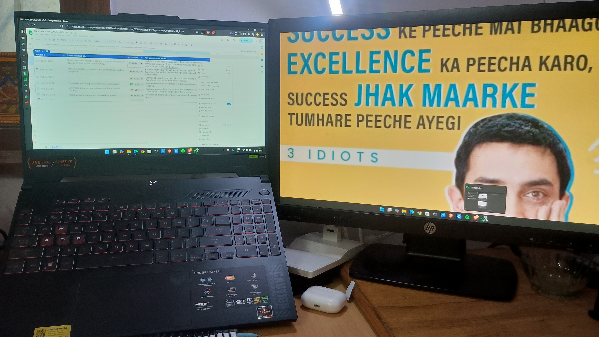
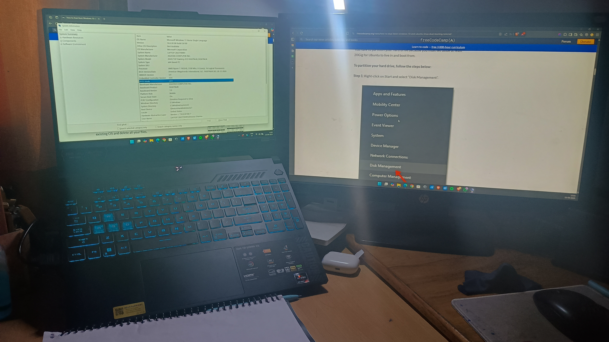
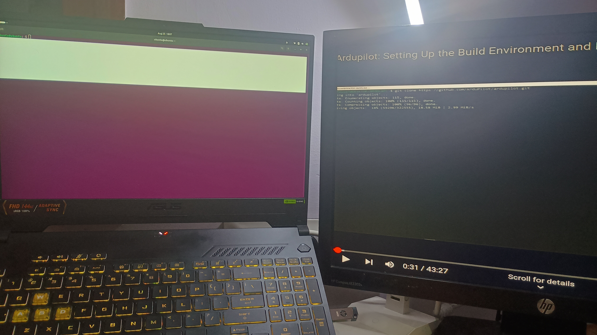

# UAV Navigation on ArduPilot SITL

Autonomous quadcopter missions written from scratch in Python with **DroneKit + MAVLink**, flown on **ArduPilot SITL**: arming and takeoff, GPS waypoint navigation, square and circular trajectories built from velocity vectors, and a **hand-written PID position controller** that flies the drone to a GPS target using haversine distance and bearing.

This was my entry point into UAV autonomy at UAS-DTU, and the base for later work on autonomous ground rovers with ROS 2, Nav2 and LiDAR.

<p align="center">
  
  
  
</p>

---

## Missions

| Script | What the drone does | Key technique |
|---|---|---|
| `takeoff.py` | Arms in GUIDED, climbs to 10 m, flies 2 m/s forward then right, lands | `simple_takeoff`, `SET_POSITION_TARGET_LOCAL_NED` velocity control |
| `final_task1_goto.py` | Waits for pre-arm checks, takes off, flies to a GPS waypoint at 30 m, returns to launch | `simple_goto`, RTL |
| `final_task2_square.py` | Flies a square by rotating a 5 m/s velocity vector 90° per side | Velocity vectors in the local NED frame |
| `final_task2_circle.py` | Approximates a circle with 30 velocity segments, each rotated 12° | Discretised circular trajectory |
| `task2circle.py` | Circle with explicit heading control | `MAV_CMD_CONDITION_YAW` |
| `task3.py` | **PID controller** that drives the drone to a GPS target and stops within 0.2 m | Haversine distance error, great-circle bearing, PID on distance → NED velocity |

### The PID controller (`task3.py`)

The flight controller's own position controller is bypassed. Instead, my loop:

1. computes the **distance error** to the target with the haversine formula,
2. computes the **bearing** to the target,
3. runs **PID on the distance error** to get a commanded speed,
4. projects that speed onto the bearing as a **NED velocity setpoint** (`vx = u·cos(bearing)`, `vy = u·sin(bearing)`),
5. stops when the drone is within 0.2 m and the commanded speed is below 0.2 m/s.

Tuning `kp`, `ki` and `kd` by hand in SITL made the classic behaviours visible: sluggish response, oscillation around the target, overshoot, and finally clean convergence.

---

## Run it

**Requirements:** ArduPilot SITL (ArduCopter), Python 3, `dronekit`, `pymavlink`, `matplotlib`.

```bash
# Terminal 1: start a simulated quadcopter
sim_vehicle.py -v ArduCopter --console --map

# Terminal 2: run a mission (each script connects to 127.0.0.1:14550)
pip install dronekit pymavlink matplotlib
python3 takeoff.py
python3 final_task2_square.py
python3 task3.py            # PID to a GPS target
```

The GPS waypoints in `final_task1_goto.py` and `task3.py` are hard-coded. Edit them to points near your SITL home location.

**Python 3.10+ note:** `dronekit` 2.9.2 still imports `collections.MutableMapping`, which was removed in Python 3.10. If you see that error, patch the import to `collections.abc.MutableMapping` or use Python 3.9.

---

## Debugging log

Getting SITL running from source on Ubuntu was its own project. `Difficulties/` has screenshots of what broke and how I fixed it:

| Issue | Fix |
|---|---|
| `./waf configure` fails: `Could not find the program ['arm-none-eabi-ar']` | `sudo apt install gcc-arm-none-eabi` installs the ARM cross-toolchain ArduPilot needs |
| The toolchain install dies with `dpkg: ... No space left on device` | Freed disk space and re-ran the install. The ARM toolchain is large |
| DroneKit fails to import on the system Python | DroneKit isn't compatible with Python 3.10+, so run it in a Python 3.8/3.9 environment (see the note above) |

---

## What came next

- Autonomous lawnmower (area-coverage) missions using ArduPilot GUIDED mode and GOTO waypoints
- Hands-on build and flight preparation of UAS-DTU airframes (Tarot, ShadowX and others)
- Autonomous ground rovers with ROS 2, Nav2, 3D LiDAR and ArduRover for the **DARPA Triage Challenge**, where UAS-DTU placed 2nd in the non-funded category

## Author

**Shourya Sharma**, Mathematics & Computing @ DTU, UAS-DTU
[LinkedIn](https://www.linkedin.com/in/shourya-sharma-6a365a341)
